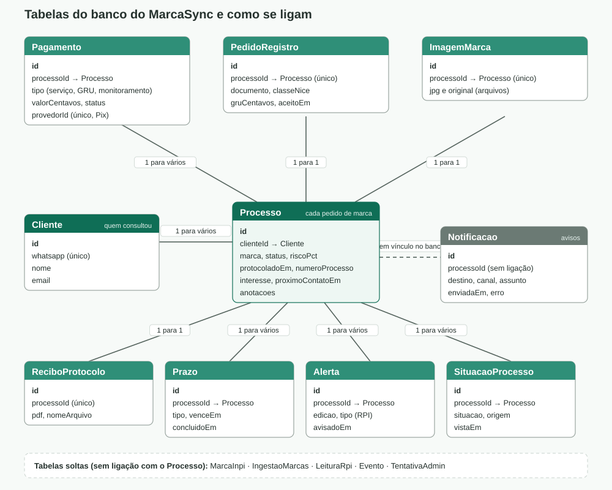
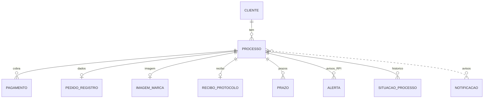

# Banco de dados: tabelas e conexões

Em texto (o GitHub desenha o diagrama abaixo sozinho):

- **Cliente** é identificado pelo WhatsApp (único). Um cliente tem vários **Processos**; cada Processo é um pedido de marca.
- Cada Processo tem vários **Pagamentos** (serviço, taxa do INPI e monitoramento) e, no máximo, um **PedidoRegistro**, uma **ImagemMarca** e um **ReciboProtocolo**.
- **Prazo**, **Alerta** (publicações da RPI) e **SituacaoProcesso** (histórico) também pertencem a um Processo.
- **Notificacao** guarda o id do processo mas **sem vínculo no banco**: o aviso fica mesmo que o processo seja apagado.
- Tabelas soltas: `MarcaInpi` (base de marcas do INPI), `IngestaoMarcas`, `LeituraRpi`, `Evento` (uso do site) e `TentativaAdmin` (senhas erradas no /admin).
- Não há remoção em cascata: para apagar um cliente, apague primeiro os filhos, depois o processo, depois o cliente.
